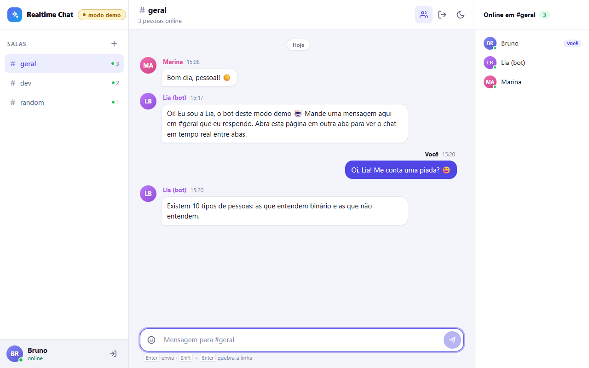

# Realtime Chat

[🇧🇷 Português](README.md) · 🇺🇸 English

A real-time chat app with rooms, online presence, a "someone is typing..." indicator and per-room
history. It is an **npm workspaces** monorepo with a **React 19 + Vite** front end, a
**Node 22 + Express + Socket.io** server and a shared package that holds the **typed event
contracts** and the **zod schemas** both sides use. GitHub Pages cannot run a server, so the front
end has a second transport that simulates the backend in the browser: tabs talk to each other
over `BroadcastChannel`, and a bot replies in `#geral`.

**Demo:** https://brunoicosta.github.io/react-realtime-chat/ (demo mode, no server; open it in two tabs)



## Highlights

- Passwordless login (nickname + avatar color). The server issues a **JWT** and checks it in the Socket.io handshake.
- Rooms with unread badges, room creation, messages grouped by author and day, optimistic sending with retry.
- Smart auto-scroll with a "new messages" pill, typing indicator, online users per room, reconnect banner.
- Per-socket rate limiting (token bucket) and zod validation of every payload.
- **Portuguese (pt-BR) and English**, with automatic detection and a flag-based language switcher (inline SVG).
- Light/dark theme, responsive layout and accessibility (labels, `aria-live`, keyboard navigation).

## Architecture

- `packages/shared`: `ClientToServerEvents` / `ServerToClientEvents`, models and zod schemas, typing the Socket.io server and client.
- `apps/server`: Express + Socket.io with an in-memory store (capped history per room), JWT auth middleware, rate limiting, and tests that use `socket.io-client` against an ephemeral server.
- `apps/web`: talks only to a `ChatTransport` interface with two implementations:
  `SocketIoTransport` (when `VITE_SERVER_URL` is set) and `BroadcastChannelTransport` (demo mode, the default on Pages, with simulated presence and a bot).

## Internationalization

i18next + react-i18next + i18next-browser-languagedetector with typed resources (`apps/web/src/core/i18n`).
The initial language comes from the saved choice, then the browser language (`pt*` -> pt-BR, otherwise English), then pt-BR.
The server returns **error codes only** and the web app translates them. Dates use the active locale.
The demo bot, seed messages and simulated chatter follow the language of the tab.
Adding a language is covered in the Portuguese README ("Internacionalização").

## Running locally

```bash
npm install
npm run dev        # server on http://localhost:3001 + web on http://localhost:5173 (concurrently)
npm run dev:demo   # web only, demo mode
npm test           # server + web tests (Vitest)
npm run lint       # ESLint + Prettier
npm run build      # shared, server and web builds
```

## Author

**Bruno Vinicius Isaac Costa** · https://github.com/BrunoICosta · [MIT](LICENSE)
