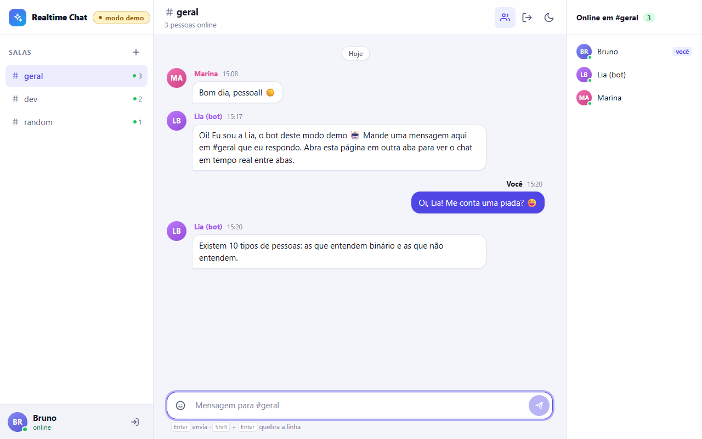

# Realtime Chat

Chat em tempo real com salas, presença online, indicador de "digitando..." e histórico por sala,
construído como um monorepo **npm workspaces**: um front-end em **React 19 + Vite**, um servidor
**Node 22 + Express + Socket.io** e um pacote compartilhado com os **contratos tipados dos eventos**
e os **schemas zod** usados pelos dois lados. Como o GitHub Pages não roda servidor, o front tem
um segundo transporte que simula o backend dentro do navegador (abas conversam entre si via
`BroadcastChannel` e um bot responde em `#geral`).

**Demo:** https://brunoicosta.github.io/react-realtime-chat/ (modo demo, sem servidor; abra em duas abas)



## Funcionalidades

- **Login sem cadastro**: apelido + cor do avatar; o servidor emite um **JWT** (HS256, 12h).
- **Salas**: `#geral`, `#dev` e `#random` por padrão, criação de novas salas, sair da sala.
- **Badges de não lidas** por sala e contador no título da aba (`(3) #geral · Realtime Chat`).
- **Mensagens agrupadas** por autor (janela de 5 min) e por dia (Hoje, Ontem, 12 de setembro).
- **Envio otimista**: a mensagem aparece na hora, é reconciliada pelo `clientId` e pode ser
  reenviada se falhar.
- **Auto-scroll inteligente**: acompanha o fim da conversa, mas se você estiver lendo mensagens
  antigas aparece a pílula "N novas mensagens".
- **"Fulano está digitando..."** com eventos _throttled_ no cliente e expiração no servidor.
- **Pessoas online** por sala (várias abas do mesmo usuário contam como uma presença).
- **Composer amigável a emoji**: Enter envia, Shift+Enter quebra linha, respeita IME, seletor
  rápido de emoji, contador de caracteres, mensagens só com emoji ficam maiores.
- **Banner de reconexão** ("Conexão perdida. Tentando reconectar…" / "Conexão restabelecida") e
  reentrada automática nas salas com merge do histórico.
- **Rate limiting** por socket (token bucket) com aviso na interface.
- Horários em **pt-BR**, **tema claro/escuro** (segue o sistema e lembra a escolha), layout
  **responsivo** com gavetas no mobile e foco em **acessibilidade** (labels, `aria-live`,
  `role="log"`, foco visível, navegação por teclado no seletor de emoji).

## Stack

| Camada    | Tecnologias                                                                                   |
| --------- | --------------------------------------------------------------------------------------------- |
| Web       | React 19.2, Vite 8.2, TypeScript 6.0, socket.io-client 4.8, CSS puro com design tokens        |
| Server    | Node 22, Express 5.2, Socket.io 4.8, jsonwebtoken 9, zod 4.4, tsx 4 (dev)                     |
| Shared    | Tipos de eventos (`ClientToServerEvents` / `ServerToClientEvents`), modelos e schemas zod     |
| Testes    | Vitest 4.1, Testing Library (React 16, user-event 14, jest-dom 7), jsdom 30, socket.io-client |
| Qualidade | ESLint 10 + typescript-eslint 8, Prettier 3, TypeScript `strict` + `noUncheckedIndexedAccess` |
| CI/CD     | GitHub Actions (lint, testes, build) e deploy do `apps/web` no GitHub Pages                   |

## Arquitetura e decisões

```
apps/web  ──(ChatTransport)──┬── SocketIoTransport ──── WebSocket ──── apps/server
                             └── BroadcastChannelTransport (modo demo, só navegador)
        ╲                                                           ╱
         └────────────── packages/shared (tipos + zod) ────────────┘
```

- **Contratos compartilhados.** `packages/shared` define `ClientToServerEvents` e
  `ServerToClientEvents`, usados para tipar o `Server` do Socket.io e o `socket` do cliente.
  Renomear um evento ou mudar um payload quebra a compilação dos dois lados. Os mesmos schemas
  zod validam o formulário no navegador e os payloads no servidor.
- **Sem etapa de build no dev.** O `package.json` do shared exporta uma condição `source`
  apontando para o TypeScript. Vite, Vitest, `tsx` (`--conditions=source`) e o `tsc` (via
  `customConditions`) consomem os fontes direto; só o build de produção do servidor usa o `dist`.
- **`ChatTransport`, a peça central do front.** A UI não conhece Socket.io: ela fala com uma
  interface (`login`, `connect`, `joinRoom`, `sendMessage`, `startTyping`, `on(evento)`...) que
  emite exatamente os mesmos eventos do servidor. Há duas implementações:
  - `SocketIoTransport`, usado quando `VITE_SERVER_URL` está definido: faz login via
    `POST /api/login`, conecta com o JWT no handshake e usa _acks_ com timeout
    (`emitWithAck`) para transformar cada pedido em uma `Promise`.
  - `BroadcastChannelTransport` (**modo demo**, padrão no GitHub Pages): cada aba é um "peer"
    que anuncia sua presença e as salas em que está por `BroadcastChannel`, com heartbeat e
    expiração de peers que somem. Salas e histórico ficam no `localStorage` (compartilhado entre
    as abas), há usuários simulados online e a **Lia (bot)** responde em `#geral` mostrando o
    indicador de digitação antes. A interface mostra o selo **"modo demo"**.

  Assim o demo público funciona de verdade (abra duas abas e converse), sem esconder que existe
  um backend real: o mesmo código de UI roda nos dois modos. Também dá para forçar o demo com
  `?demo` na URL.

- **Estado com `useReducer` + Context.** Um reducer puro (`chat-reducer.ts`) concentra as
  regras: mensagens otimistas, contagem de não lidas, merge de histórico após reconexão,
  ordenação. O provider separa contexto de estado e de ações para evitar renders desnecessários.
  Não foi preciso uma biblioteca de estado.
- **Servidor em memória por design.** `ChatStore` guarda salas, um histórico limitado por sala
  (100 mensagens), presença por usuário (com várias conexões) e sessões. Nada de banco: o foco é
  o tempo real. A identidade sempre vem do JWT verificado no middleware do Socket.io
  (`socket.data.user`), nunca do payload.
- **Robustez no servidor.** Todo payload passa por zod; o ack é normalizado (cliente malicioso
  pode não mandar callback); rate limit por socket com _token bucket_ (mensagens, digitação e
  operações de sala com orçamentos separados); `maxHttpBufferSize` baixo; "digitando" expira
  sozinho; CORS aceita qualquer porta de `localhost` apenas fora de produção.
- **Testes de verdade no servidor.** Cada teste sobe um servidor isolado em porta efêmera e
  conversa com ele usando `socket.io-client` (auth, salas, presença, mensagens, digitação,
  rate limit). No front, testes do reducer, dos helpers, do transporte demo (com um
  `BroadcastChannel` falso e timers falsos) e de componentes com Testing Library.

## Como rodar

Pré-requisito: **Node 22.12+** e npm 10.

```bash
npm install
npm run dev        # sobe o servidor (http://localhost:3001) e o web (http://localhost:5173) juntos
```

O `npm run dev` usa o `concurrently`; o web lê `VITE_SERVER_URL` de `apps/web/.env.development`.
Abra duas janelas (ou uma anônima) para conversar com você mesmo.

Outros comandos:

```bash
npm run dev:demo   # só o front, em modo demo (BroadcastChannel), sem servidor
npm test           # testes do servidor e do web (Vitest)
npm run lint       # ESLint + Prettier
npm run typecheck  # tsc em todos os workspaces
npm run build      # build do shared, do servidor (apps/server/dist) e do web (apps/web/dist)
npm start          # roda o servidor buildado (node apps/server/dist/index.js)
```

Variáveis do servidor (veja `apps/server/.env.example`; um `.env` em `apps/server` é carregado
automaticamente): `PORT`, `CORS_ORIGIN` (lista separada por vírgula), `JWT_SECRET` (obrigatório
em produção) e `JWT_EXPIRES_IN_SECONDS`.

## Estrutura de pastas

```
.
├── apps
│   ├── server
│   │   ├── src
│   │   │   ├── auth/          # login (POST /api/login) e serviço de JWT
│   │   │   ├── chat/          # ChatStore em memória, TypingTracker, rate limiter
│   │   │   ├── socket/        # Socket.io: middleware de auth, handlers, acks
│   │   │   ├── app.ts         # Express (CORS, JSON, health, 404)
│   │   │   ├── config.ts      # env validado com zod
│   │   │   └── server.ts      # composição HTTP + Socket.io (usada também nos testes)
│   │   └── test/              # testes de integração com socket.io-client
│   └── web
│       └── src
│           ├── core/          # transporte (interface, Socket.io, demo), sessão, tema
│           ├── features/
│           │   ├── auth/      # tela de login
│           │   └── chat/      # provider + reducer, componentes, hooks e helpers
│           ├── shared/        # Avatar, Icon, DemoBadge, ThemeToggle...
│           └── styles/        # tokens de design e primitivas
├── packages
│   └── shared/src             # eventos tipados, modelos, schemas zod, constantes
└── .github/workflows          # CI e deploy no GitHub Pages
```

## Próximos passos

- Persistência (PostgreSQL/Redis) e adapter Redis do Socket.io para escalar horizontalmente.
- Paginação do histórico ("carregar mensagens anteriores") com scroll infinito para cima.
- Mensagens diretas, menções com `@`, reações e edição/remoção de mensagens.
- Confirmação de leitura e notificações do navegador.
- Testes end-to-end com Playwright cobrindo duas abas no modo demo.

## Autor

**Bruno Vinicius Isaac Costa** · https://github.com/BrunoICosta

Licença [MIT](LICENSE).
